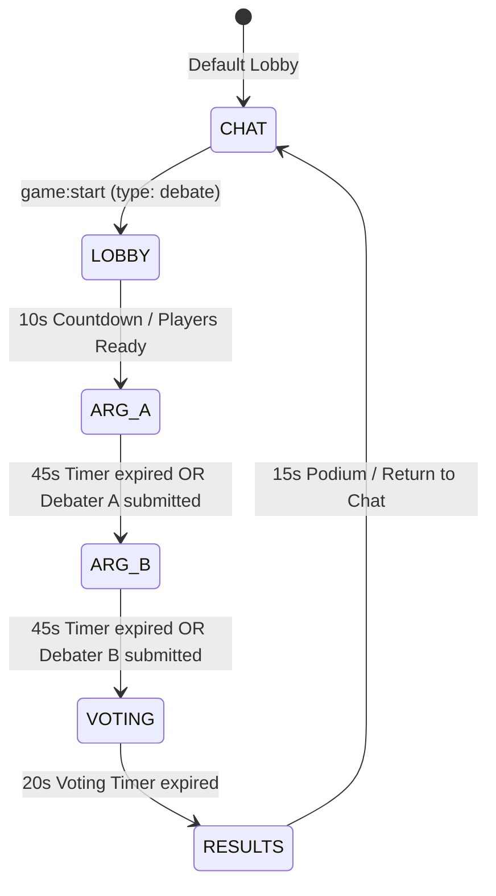
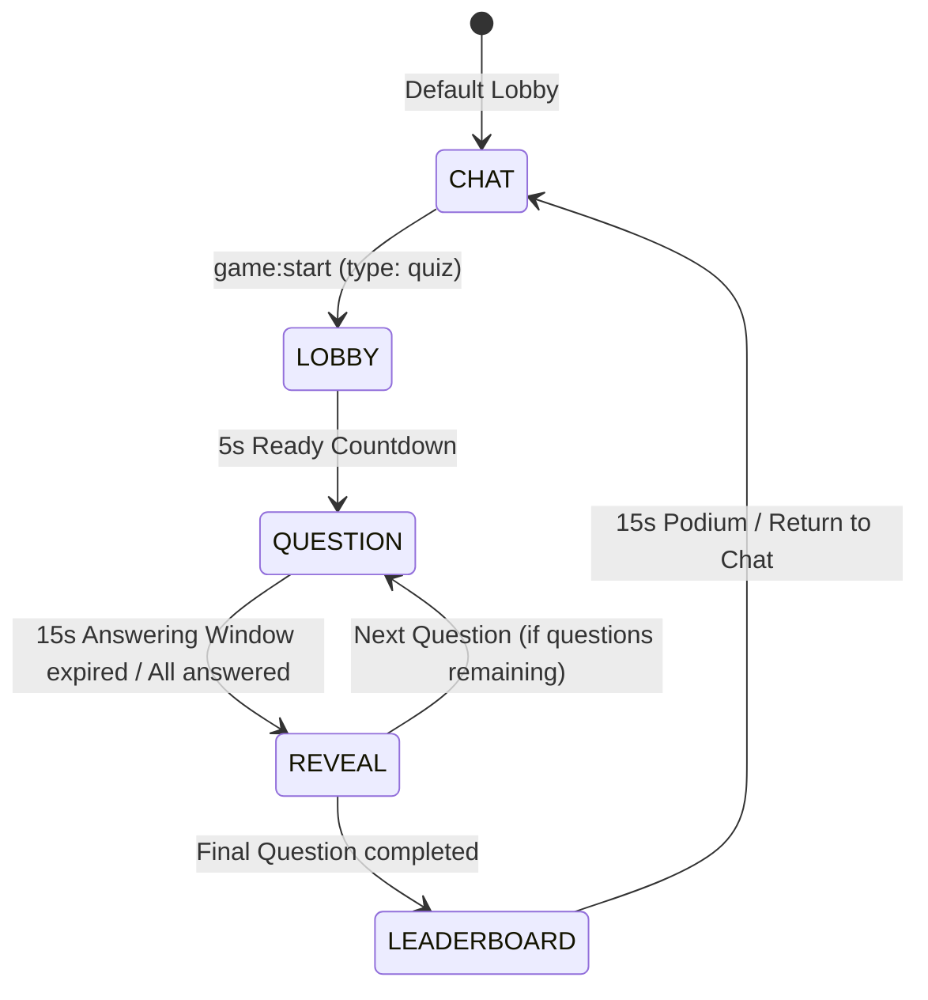

# 📜 CONTRACTS.md — PORChat Specifications, WebSockets & FSM

This document defines the single source of truth for all API contracts, WebSocket event schemas, Finite State Machines (FSM), database schemas, and implementation plans for the **PORChat** ecosystem.

---

## 1. Architectural Decisions Summary

Based on the alignment process (Uno-Reverse & Double-Diamond Inception):

- **Backend (`/api`):** Go (Golang) REST API + WebSocket Hub.
- **Database:** PostgreSQL conteinerizado via `docker-compose.yml` com migrações SQL nativas (`golang-migrate` ou script SQL).
- **Authentication:** REST-based (`/api/auth/register`, `/api/auth/login`) com senha hasheada via `bcrypt` e emissão de **JWT** (JSON Web Token).
- **Monorepo Layout:** Minimalista na raiz (`/api`, `/web`, `/mobile`) orquestrado via `Makefile` e `docker-compose.yml`.
- **WebSocket Handshake:** Query parameters na URL para autenticação e identificação de tela:
  `ws://<host>/ws?token=<JWT>&room_id=<ROOM_ID>&client_type=<web|mobile|tv>`

---

## 2. Database Schema (PostgreSQL)

```sql
-- Users
CREATE TABLE users (
    id UUID PRIMARY KEY DEFAULT gen_random_uuid(),
    nickname VARCHAR(50) NOT NULL UNIQUE,
    email VARCHAR(255) NOT NULL UNIQUE,
    password_hash VARCHAR(255) NOT NULL,
    avatar_url TEXT,
    created_at TIMESTAMP WITH TIME ZONE DEFAULT CURRENT_TIMESTAMP,
    updated_at TIMESTAMP WITH TIME ZONE DEFAULT CURRENT_TIMESTAMP
);

-- Rooms / Groups
CREATE TABLE rooms (
    id UUID PRIMARY KEY DEFAULT gen_random_uuid(),
    name VARCHAR(100) NOT NULL,
    code VARCHAR(10) UNIQUE NOT NULL, -- e.g. "POR-4821" for quick join
    is_group BOOLEAN DEFAULT true,
    created_by UUID REFERENCES users(id) ON DELETE SET NULL,
    created_at TIMESTAMP WITH TIME ZONE DEFAULT CURRENT_TIMESTAMP
);

-- Room Memberships
CREATE TABLE room_members (
    room_id UUID REFERENCES rooms(id) ON DELETE CASCADE,
    user_id UUID REFERENCES users(id) ON DELETE CASCADE,
    role VARCHAR(20) DEFAULT 'member', -- 'owner', 'admin', 'member'
    joined_at TIMESTAMP WITH TIME ZONE DEFAULT CURRENT_TIMESTAMP,
    PRIMARY KEY (room_id, user_id)
);

-- Chat Messages
CREATE TABLE messages (
    id UUID PRIMARY KEY DEFAULT gen_random_uuid(),
    room_id UUID REFERENCES rooms(id) ON DELETE CASCADE,
    user_id UUID REFERENCES users(id) ON DELETE SET NULL,
    content TEXT NOT NULL,
    type VARCHAR(20) DEFAULT 'text', -- 'text', 'game_card', 'system'
    metadata JSONB DEFAULT '{}',
    created_at TIMESTAMP WITH TIME ZONE DEFAULT CURRENT_TIMESTAMP
);

-- Game Sessions (Audit & Rankings)
CREATE TABLE game_sessions (
    id UUID PRIMARY KEY DEFAULT gen_random_uuid(),
    room_id UUID REFERENCES rooms(id) ON DELETE CASCADE,
    game_type VARCHAR(30) NOT NULL, -- 'debate', 'quiz'
    winner_id UUID REFERENCES users(id) ON DELETE SET NULL,
    state JSONB NOT NULL DEFAULT '{}',
    started_at TIMESTAMP WITH TIME ZONE DEFAULT CURRENT_TIMESTAMP,
    ended_at TIMESTAMP WITH TIME ZONE
);
```

---

## 3. REST API Specification

### Base URL: `/api`

| Method | Endpoint | Auth | Description |
| :--- | :--- | :--- | :--- |
| `POST` | `/api/auth/register` | Public | Registers a new user with email, nickname, password. Returns `{ user, token }`. |
| `POST` | `/api/auth/login` | Public | Authenticates user credentials. Returns `{ user, token }`. |
| `GET` | `/api/auth/me` | Bearer JWT | Returns current authenticated user profile. |
| `GET` | `/api/rooms` | Bearer JWT | Lists all rooms the user belongs to. |
| `POST` | `/api/rooms` | Bearer JWT | Creates a new chat room/group. |
| `GET` | `/api/rooms/:id` | Bearer JWT | Returns room metadata and member list. |
| `POST` | `/api/rooms/join` | Bearer JWT | Joins a room using its short code (e.g. `{ "code": "POR-4821" }`). |
| `GET` | `/api/rooms/:id/messages`| Bearer JWT | Paginated chat history (`?limit=50&before=<timestamp>`). |

---

## 4. WebSocket Protocol & Event Catalog

### 4.1 Handshake & Envelope

- **Endpoint:** `GET /ws`
- **Query Parameters:**
  - `token`: Bearer JWT issued upon login/registration.
  - `room_id`: Target room UUID.
  - `client_type`: `web` (regular chat client), `mobile` (controller/chat), or `tv` (spectator stage).

- **Standard JSON Envelope (All WebSocket Messages):**
```json
{
  "event": "string",
  "room_id": "string",
  "timestamp": 1761090000000,
  "payload": {}
}
```

---

### 4.2 System & Presence Events

#### `sys:connected` (Server -> Client)
Sent immediately upon successful handshake.
```json
{
  "event": "sys:connected",
  "room_id": "9b1deb4d-3b7d-4bad-9bdd-2b0d7b3dcb6d",
  "timestamp": 1761090000000,
  "payload": {
    "user": {
      "id": "11111111-1111-1111-1111-111111111111",
      "nickname": "Otavio",
      "avatar_url": null
    },
    "client_type": "mobile",
    "online_users": [
      { "id": "11111111-1111-1111-1111-111111111111", "nickname": "Otavio" },
      { "id": "22222222-2222-2222-2222-222222222222", "nickname": "Pedro" }
    ],
    "active_game": null
  }
}
```

#### `sys:user_joined` & `sys:user_left` (Server -> Room)
```json
{
  "event": "sys:user_joined",
  "room_id": "9b1deb4d-3b7d-4bad-9bdd-2b0d7b3dcb6d",
  "timestamp": 1761090000000,
  "payload": {
    "user_id": "33333333-3333-3333-3333-333333333333",
    "nickname": "Raul",
    "client_type": "web"
  }
}
```

---

### 4.3 Chat Events

#### `chat:send` (Client -> Server)
```json
{
  "event": "chat:send",
  "room_id": "9b1deb4d-3b7d-4bad-9bdd-2b0d7b3dcb6d",
  "timestamp": 1761090000000,
  "payload": {
    "content": "Bora começar um debate aí?"
  }
}
```

#### `chat:new_message` (Server -> Room)
```json
{
  "event": "chat:new_message",
  "room_id": "9b1deb4d-3b7d-4bad-9bdd-2b0d7b3dcb6d",
  "timestamp": 1761090000000,
  "payload": {
    "id": "aaaa-bbbb-cccc-dddd",
    "user_id": "11111111-1111-1111-1111-111111111111",
    "nickname": "Otavio",
    "content": "Bora começar um debate aí?",
    "type": "text",
    "created_at": "2026-10-21T23:30:00Z"
  }
}
```

---

### 4.4 Game Core Lifecycle Events

#### `game:start` (Client -> Server)
Triggers a game in the current room.
```json
{
  "event": "game:start",
  "room_id": "9b1deb4d-3b7d-4bad-9bdd-2b0d7b3dcb6d",
  "timestamp": 1761090000000,
  "payload": {
    "game_type": "debate", // or "quiz"
    "topic": "Abacaxi na pizza é crime ou alta gastronomia?",
    "debater_a_id": "11111111-1111-1111-1111-111111111111",
    "debater_b_id": "22222222-2222-2222-2222-222222222222"
  }
}
```

#### `game:state_update` (Server -> Room)
Broadcasted whenever the game FSM transitions or tick sync occurs.
```json
{
  "event": "game:state_update",
  "room_id": "9b1deb4d-3b7d-4bad-9bdd-2b0d7b3dcb6d",
  "timestamp": 1761090000000,
  "payload": {
    "game_type": "debate",
    "phase": "VOTING",
    "phase_ends_at": 1761090045000,
    "remaining_seconds": 15,
    "state": {
      "topic": "Abacaxi na pizza é crime ou alta gastronomia?",
      "debater_a": { "id": "1111...", "nickname": "Otavio", "argument": "É agridoce e equilibra o salgado!" },
      "debater_b": { "id": "2222...", "nickname": "Pedro", "argument": "Destrói a tradição e umedece a massa!" },
      "votes_count": { "side_a": 4, "side_b": 2 }
    }
  }
}
```

#### `game:tick` (Server -> Room)
Emitted every 1 second by the backend ticker during timed phases.
```json
{
  "event": "game:tick",
  "room_id": "9b1deb4d-3b7d-4bad-9bdd-2b0d7b3dcb6d",
  "timestamp": 1761090000000,
  "payload": {
    "remaining_seconds": 9,
    "phase_ends_at": 1761090045000
  }
}
```

---

### 4.5 Mode 1: Debate Mode ("The Court") Events

#### `debate:submit_argument` (Client Debater -> Server)
```json
{
  "event": "debate:submit_argument",
  "room_id": "9b1deb4d-3b7d-4bad-9bdd-2b0d7b3dcb6d",
  "timestamp": 1761090000000,
  "payload": {
    "argument": "O contraste doce-salgado é amplamente reconhecido na culinária mundial."
  }
}
```

#### `debate:cast_vote` (Client Juror -> Server)
```json
{
  "event": "debate:cast_vote",
  "room_id": "9b1deb4d-3b7d-4bad-9bdd-2b0d7b3dcb6d",
  "timestamp": 1761090000000,
  "payload": {
    "choice": "side_a" // "side_a" or "side_b"
  }
}
```

#### `debate:reaction` (Client Mobile -> Server)
```json
{
  "event": "debate:reaction",
  "room_id": "9b1deb4d-3b7d-4bad-9bdd-2b0d7b3dcb6d",
  "timestamp": 1761090000000,
  "payload": {
    "emoji": "🔥" // "🔥", "🍅", "👏", "🤯"
  }
}
```

#### `tv:reaction_stream` (Server -> TV Mode)
Batched reactions emitted to TV screens for high-performance floating particle rendering:
```json
{
  "event": "tv:reaction_stream",
  "room_id": "9b1deb4d-3b7d-4bad-9bdd-2b0d7b3dcb6d",
  "timestamp": 1761090000000,
  "payload": {
    "reactions": [
      { "emoji": "🔥", "count": 5 },
      { "emoji": "🍅", "count": 2 }
    ]
  }
}
```

---

### 4.6 Mode 2: Quick Trivia ("Quiz Relâmpago") Events

#### `quiz:submit_answer` (Client Mobile -> Server)
```json
{
  "event": "quiz:submit_answer",
  "room_id": "9b1deb4d-3b7d-4bad-9bdd-2b0d7b3dcb6d",
  "timestamp": 1761090000000,
  "payload": {
    "question_index": 0,
    "choice": "B", // "A", "B", "C", "D"
    "client_sent_ms": 1761090005230
  }
}
```

#### `quiz:round_reveal` (Server -> Room)
```json
{
  "event": "quiz:round_reveal",
  "room_id": "9b1deb4d-3b7d-4bad-9bdd-2b0d7b3dcb6d",
  "timestamp": 1761090000000,
  "payload": {
    "correct_option": "B",
    "answers_distribution": { "A": 1, "B": 6, "C": 0, "D": 2 },
    "leaderboard": [
      { "user_id": "1111...", "nickname": "Otavio", "round_score": 920, "total_score": 920 },
      { "user_id": "2222...", "nickname": "Pedro", "round_score": 850, "total_score": 850 }
    ]
  }
}
```

---

## 5. Finite State Machines (FSM)

### 5.1 Debate Mode FSM ("The Court")



| Phase | Duration | Debater A View | Debater B View | Juror (Audience) View | TV Mode View |
| :--- | :--- | :--- | :--- | :--- | :--- |
| `LOBBY` | 10s | Ready banner & Side A color | Ready banner & Side B color | "Waiting for court session" | Topic card + Debater match-up screen |
| `ARG_A` | 45s | Input textarea + Submit button | "Debater A is speaking..." | "Debater A is speaking..." + Emoji triggers | Live countdown + Side A spotlight |
| `ARG_B` | 45s | "Debater B is speaking..." | Input textarea + Submit button | "Debater B is speaking..." + Emoji triggers | Live countdown + Side B spotlight |
| `VOTING` | 20s | "Audience is voting..." | "Audience is voting..." | 2 massive buttons (A: Coral vs B: Mint) | Big voting timer + live floating emoji reactions |
| `RESULTS`| 15s | Winner / Loser banner | Winner / Loser banner | Winner banner + vote tallies | Animated crown + confetti + final score breakdown |

---

### 5.2 Quick Trivia FSM ("Quiz Relâmpago")



#### Scoring Rule (Server-Calculated):
$$\text{Score} = \begin{cases} 
\text{clamp}\left(1000 \times \left(1 - \frac{\Delta t}{T_{\text{max}}}\right), 200, 1000\right) & \text{if answer is correct} \\ 
0 & \text{if incorrect}
\end{cases}$$
Onde $\Delta t$ é medido no Go backend pelo timestamp de recepção do payload.

---

## 6. Monorepo Structure

```text
PORChat/
├── .agents/                    # Custom agent skills and rules
│   └── skills/
├── api/                        # Go (Golang) Backend
│   ├── cmd/
│   │   └── server/             # main.go entrypoint
│   ├── internal/
│   │   ├── auth/               # User registration, bcrypt, JWT
│   │   ├── chat/               # Rooms, messages, database queries
│   │   ├── game/               # FSM engine (Debate & Quiz), tickers
│   │   └── ws/                 # WebSocket Hub, Client, Envelope router
│   ├── migrations/             # SQL schema migrations (001_init.sql)
│   ├── go.mod
│   └── go.sum
├── web/                        # Next.js 14 Web Application
│   ├── src/
│   │   ├── app/
│   │   │   ├── (auth)/         # /login, /register
│   │   │   ├── chat/           # Standard web chat client
│   │   │   └── tv/             # /tv/[roomId] TV Mode big screen stage
│   │   ├── components/         # Shared UI components
│   │   └── lib/                # WebSocket client, API fetcher, auth store
│   ├── tailwind.config.ts
│   └── package.json
├── mobile/                     # React Native Mobile App
│   ├── src/
│   │   ├── screens/            # ChatScreen, LoginScreen, RegisterScreen
│   │   ├── components/
│   │   │   └── controller/     # DebateBuzzer, QuizButtons, ReactionBar
│   │   └── services/           # Global WebSocket context / Zustand store
│   └── package.json
├── docker-compose.yml          # PostgreSQL container
├── Makefile                    # dev, build, test, migrate commands
├── AGENTS.md                   # Architecture & Guidelines
└── CONTRACTS.md                # This document
```

---

## 7. Execution Plan (Independent Parallel Work Packages)

```mermaid
gantt
    title PORChat MVP Delivery Roadmap
    dateFormat  X
    axisFormat %s
    section Foundation
    WP1 Database & Docker        :active, wp1, 0, 2
    section Backend
    WP2 Go REST & Auth           :wp2, 2, 4
    WP3 Go WebSockets & FSM      :wp3, 4, 7
    section Frontends
    WP4 Next.js Web & TV Mode    :wp4, 4, 7
    WP5 React Native Controller  :wp5, 4, 7
    section Integration
    WP6 E2E Verification & Polish:wp6, 7, 9
```



### Work Package Breakdown:

- **WP1: Infrastructure & Database (`/docker-compose.yml`, `/api/migrations`)**
  - PostgreSQL container setup with health check.
  - SQL schema migrations (`users`, `rooms`, `room_members`, `messages`, `game_sessions`).

- **WP2: Go REST API & Authentication (`/api/internal/auth`, `/api/internal/chat`)**
  - User model, bcrypt password hashing, JWT generation & validation middleware.
  - Room creation, join by code, and message history endpoints.

- **WP3: Real-Time Engine & Game FSM (`/api/internal/ws`, `/api/internal/game`)**
  - Thread-safe Hub/Room manager with `sync.RWMutex`.
  - WebSocket connection upgrader with query param auth (`token`, `room_id`, `client_type`).
  - Debate FSM (`LOBBY` -> `ARG_A` -> `ARG_B` -> `VOTING` -> `RESULTS`).
  - Quiz FSM with sub-second accuracy score calculation.

- **WP4: Next.js Web Client & TV Mode Stage (`/web`)**
  - Tailwind tokens configured (`#6C5CE7`, `#FF7675`, `#FDCB6E`, `#1E1E2E`).
  - Chat layout with message stream and inline game invite cards.
  - Dedicated `/tv/[roomId]` full-screen projector stage with countdown timers, argument spotlight, and floating particle stream.

- **WP5: React Native Mobile Controller (`/mobile`)**
  - Mobile chat feed with persistent WebSocket connection.
  - Dynamic Game Controller screen that transforms into Side A vs Side B voting buzzer during `VOTING` phase, and 4 colored geometry buttons during Quiz.
  - Tactile press feedback (`Pressable`) and live emoji reaction burst bar.

- **WP6: End-to-End Verification & Polish**
  - Multi-client simulation (TV Mode on Web + 2 Mobile Controllers + Go Backend).
  - Verify seamless reconnects (`game:state_sync`).
