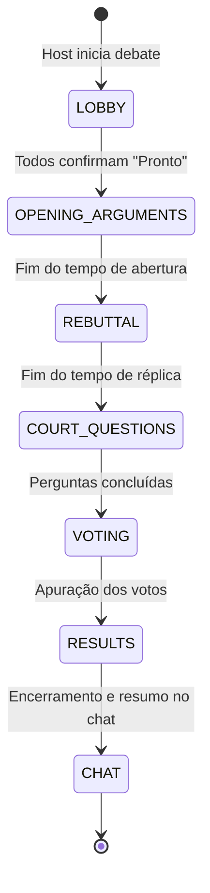

# 🎮 Motor de Jogos & Máquina de Estados (FSM) — PORChat

O motor de jogos do **PORChat** é 100% autoritativo no servidor (*Server-Authoritative Game Engine*). Clientes Web e Mobile nunca calculam pontuações nem controlam temporizadores localmente.

---

## 1. Princípio de Autoridade Estrita do Servidor

1. **Relógio Único (`time.Ticker`):**
   - O backend em Go é o único detentor do tempo de cada partida.
   - A cada segundo, o servidor transmite um evento `game:tick` contendo os segundos restantes (`time_remaining`) e a estampa de tempo final de fase (`phase_end_timestamp` em Unix ms).
   - Os clientes utilizam essa estampa de tempo para renderizar barras de progresso contínuas e fluidas via CSS/Animated sem divergências entre dispositivos.
2. **Prevenção de Trapaças:**
   - Votos e respostas recebidos após o encerramento da fase no servidor são rejeitados silenciosamente.
   - O cálculo do tempo de resposta no Quiz Relâmpago é medido pela diferença entre o timestamp de envio da pergunta pelo servidor e o timestamp de recepção da resposta no socket.

---

## 2. Modo 1: Debate ("The Court" / Tribunal)

O Modo Debate transforma a sala de chat em uma arena formal de argumentação entre dois participantes, enquanto os demais atuam como jurados e a TV projeta o palco do julgamento.

### 2.1 Papéis de Jogo
- **Debatedor A (Coral `#FF7675`):** Defende a tese ou Lado A.
- **Debatedor B (Mint `#00CEC9`):** Defende a antítese ou Lado B.
- **Jurados (Audiência):** Demais participantes da sala que avaliam os argumentos e votam no vencedor.

### 2.2 Fases da Máquina de Estados (FSM)

1. **`LOBBY` (10s a 30s):**
   - Os debatedores e a plateia entram na sala de espera do tribunal.
   - Os debatedores confirmam prontidão enviando `game:player_ready`.
2. **`OPENING_ARGUMENTS` (45s a 60s):**
   - Cada debatedor envia seu argumento principal via mobile ou web.
   - O argumento é projetado em tempo real em destaque no **Modo TV**.
   - Os jurados enviam reações flutuantes ao vivo que sobem na tela do palco.
3. **`REBUTTAL` (30s a 45s):**
   - Fase de réplica / tréplica onde os debatedores rebatem os pontos do oponente.
4. **`COURT_QUESTIONS` (30s):**
   - Jurados podem enviar perguntas rápidas da corte para os debatedores responderem.
5. **`VOTING` (20s a 30s):**
   - Os celulares dos jurados se transformam em duas cartas táteis gigantes:
     - **Lado A (Coral `#FF7675`)** vs. **Lado B (Mint `#00CEC9`)**.
   - O voto é registrado no servidor com proteção contra voto duplo.
6. **`RESULTS` (15s):**
   - O servidor contabiliza os votos e proclama o vencedor.
   - O Modo TV exibe a coroa de ouro (`#FDCB6E`) e o ranking acumulado da sala.
   - Um card de resumo (`game_card`) é publicado automaticamente no feed do chat da sala.
7. **`CHAT`:**
   - A sala retorna automaticamente para o modo de conversa convencional.

---

## 3. Modo 2: Quiz Relâmpago (Quick Trivia)

O Modo Quiz Relâmpago é um jogo de perguntas de múltipla escolha sincronizado entre todos os participantes da sala.

### 3.1 Dinâmica de Resposta & Cores Táteis
Ao iniciar uma rodada, o servidor projeta a pergunta e 4 alternativas na tela da TV / Web. Nos celulares dos jogadores, a tela se converte em 4 botões geométricos coloridos:

| Opção | Cor | Token Hex |
| :--- | :--- | :--- |
| **Opção A** | Coral Vibrante | `#FF6B6B` |
| **Opção B** | Azul Oceano | `#48DBFB` |
| **Opção C** | Amarelo Mostarda | `#FECA57` |
| **Opção D** | Verde Esmeralda | `#1DD1A1` |

### 3.2 Fórmula de Pontuação (Precisão + Velocidade)
Para recompensar tanto o conhecimento quanto a rapidez:

$$\text{Pontos} = \begin{cases} 1000 \times \left(1 - \dfrac{\Delta t_{\text{resposta}}}{2 \times \Delta t_{\text{máximo}}}\right) \times \text{Multiplicador de Streak}, & \text{se correta} \\ 0, & \text{se incorreta} \end{cases}$$

- **$\Delta t_{\text{resposta}}$:** Tempo decorrido em milissegundos desde o envio da pergunta pelo servidor.
- **Multiplicador de Streak:** Sequência de acertos consecutivos concede bônus adicional ($1.1\times$, $1.25\times$, $1.5\times$).

### 3.3 Fases do Quiz (FSM)
1. `LOBBY`: Jogadores se preparam.
2. `QUESTION` (15s a 25s): Pergunta aberta para respostas.
3. `ANSWER_REVEAL` (5s): Servidor revela a alternativa correta e o número de escolhas por opção.
4. `LEADERBOARD` (8s): Placar parcial da rodada com posições e variações de pontos.
5. `RESULTS` / `PODIUM` (15s): Pódio final dos três melhores colocados e retorno para o chat.

---

## 4. Banco de Tópicos e Perguntas Personalizadas

Os participantes de uma sala podem enriquecer seus jogos criando tópicos e perguntas próprias através das rotas da API:
- `GET /api/rooms/{id}/topics` & `POST /api/rooms/{id}/topics`
- `GET /api/rooms/{id}/questions` & `POST /api/rooms/{id}/questions`

As questões criadas são persistidas em `data/custom_bank.json` e incorporadas automaticamente nas partidas subsequentes daquela sala.
